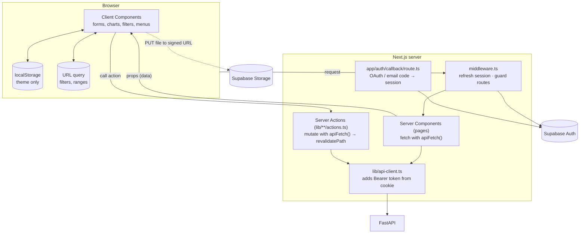
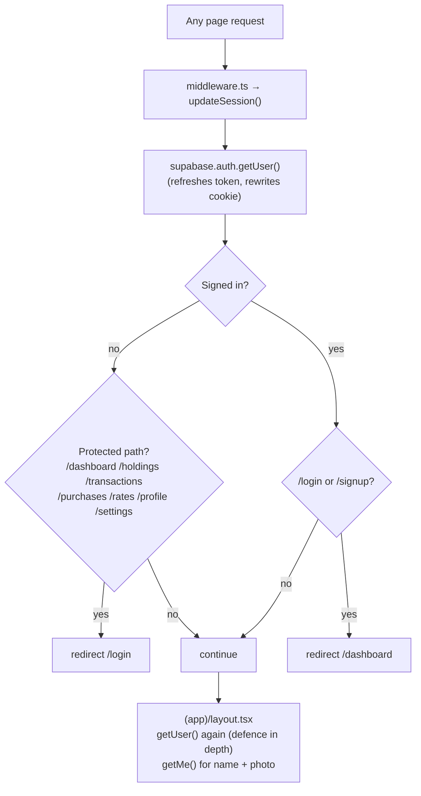
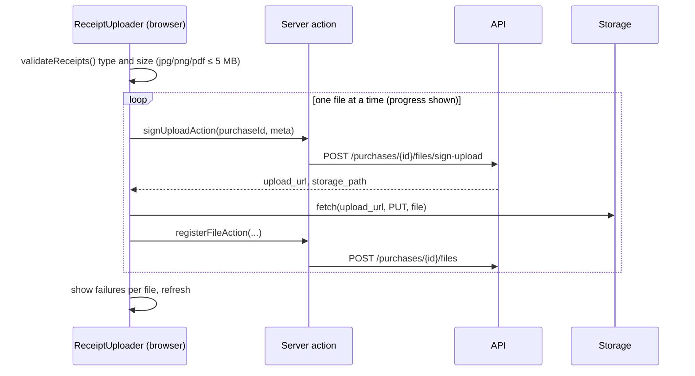
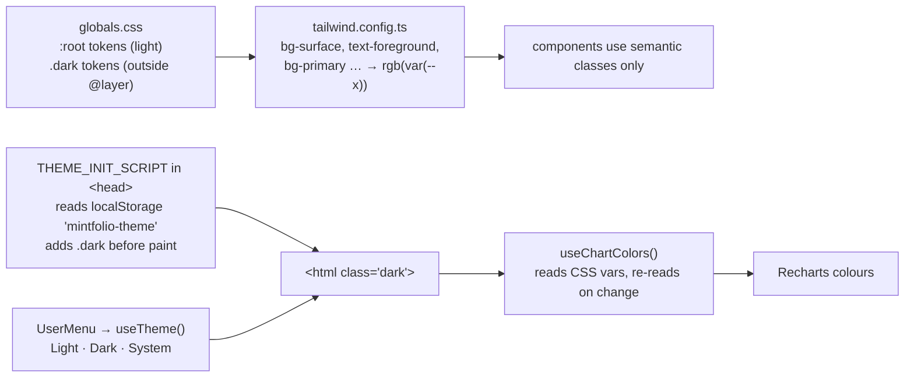

# Web architecture (low level)

> **What this covers:** how `mintfolio-web` is built: routes, where data is fetched, how mutations work, the auth and session handling, uploads, theming, and the component map.
> **Big picture first?** Read the project-wide [Architecture](https://github.com/aa055/mintfolio-docs/blob/main/docs/02-architecture.md). (Project-wide docs live in the [mintfolio-docs](https://github.com/aa055/mintfolio-docs) repo.)

---

## 1. The model in one picture



**Three rules**

1. **Pages fetch on the server.** A page is an async Server Component that calls `apiFetch()`. Data arrives as props, so there is no client-side data library and no token in the browser.
2. **Changes go through Server Actions.** Forms and buttons call functions in `lib/*/actions.ts`. These call the API and then `revalidatePath()` or `router.refresh()`, so the server re-renders with fresh data.
3. **Client state is tiny.** It's form state (react-hook-form), UI toggles, the **URL** for filters and ranges, and **localStorage** for the theme. Nothing else.

---

## 2. Folder map

```
mintfolio-web/
├── middleware.ts                 runs updateSession() on every page request
├── app/
│   ├── layout.tsx                <html>, fonts (Inter + Fraunces), theme init script
│   ├── page.tsx                  marketing landing page (/)
│   ├── not-found.tsx             branded 404
│   ├── icon.svg                  favicon
│   ├── globals.css               theme tokens (light in @layer base, .dark outside it)
│   ├── auth/callback/route.ts    OAuth + email-confirm code exchange → /auth/sync
│   ├── (auth)/                   login, signup, signup/success (centered card layout)
│   └── (app)/                    signed-in area
│       ├── layout.tsx            shell: sidebar, top bar + avatar menu, phone tab bar
│       ├── error.tsx             in-shell error screen ("Try again")
│       ├── dashboard/            Home
│       ├── holdings/
│       ├── transactions/
│       ├── purchases/new · [id] · [id]/edit
│       ├── rates/
│       ├── profile/
│       └── settings/
│           (each folder: page.tsx + loading.tsx)
├── components/
│   ├── ui/                       shadcn primitives: button, card, dialog, dropdown-menu, input, label, select, textarea
│   ├── shell/                    sidebar, mobile-tab-bar, user-menu, nav.ts, page-skeletons, coming-soon
│   ├── home/                     rate-cards, summary-tiles, performance-chart, allocation-card, recent-transactions
│   ├── holdings/                 metal-cards, holdings-table, premium-note
│   ├── transactions/             transactions-view
│   ├── purchases/                purchase-form, purchase-items, holding-actions (sell/undo/delete), receipt-strip, receipt-uploader
│   ├── rates/                    rates-view
│   ├── profile/                  profile-form
│   ├── settings/                 settings-form
│   └── auth/                     auth-form, google-button
├── lib/
│   ├── api-client.ts             apiFetch(), ApiError, apiErrorMessage()
│   ├── api-types.ts              TypeScript copy of the API schemas
│   ├── me.ts                     getMe(): /auth/me, cached once per request
│   ├── auth/                     actions.ts (login, signup, Google, logout), sync.ts (sync body)
│   ├── purchases/                actions.ts, file-actions.ts, upload.ts (browser upload loop)
│   ├── sales/actions.ts · settings/actions.ts · profile/actions.ts
│   ├── supabase/                 server.ts, middleware.ts, env.ts (client.ts unused)
│   ├── theme.ts                  useTheme(), THEME_INIT_SCRIPT
│   ├── use-chart-colors.ts       resolves CSS tokens for Recharts (live on theme change)
│   └── utils.ts                  cn(), formatCurrency, formatSignedCurrency, formatWeight, plTone…
├── e2e/                          Playwright specs + setup/teardown (see development.md)
└── docs/                         you are here
```

---

## 3. Route map

| URL | File | Server fetches (API) | Main client component |
|---|---|---|---|
| `/` | `app/page.tsx` | — | static landing |
| `/login`, `/signup`, `/signup/success` | `app/(auth)/…` | — (server actions on submit) | `AuthForm`, `GoogleButton` |
| `/auth/callback` | `app/auth/callback/route.ts` | `POST /auth/sync` | — (redirects) |
| `/dashboard` (Home) | `(app)/dashboard/page.tsx` | `/auth/me` → in parallel `/summary`, `/history?range=ALL`, `/transactions?limit=100` | `PerformanceChart`, `RecentTransactions` |
| `/holdings` | `(app)/holdings/page.tsx` | `/auth/me` → `/purchases` + `/summary` | `HoldingsTable` |
| `/transactions` | `(app)/transactions/page.tsx` | `/auth/me` → `/transactions` | `TransactionsView` |
| `/purchases/new` | `(app)/purchases/new/page.tsx` | `/auth/me` | `PurchaseForm` |
| `/purchases/[id]` | `(app)/purchases/[id]/page.tsx` | `/purchases/{id}` → `/summary` | `PurchaseItems`, `HoldingActions`, `ReceiptStrip` |
| `/purchases/[id]/edit` | `(app)/purchases/[id]/edit/page.tsx` | `/purchases/{id}` | `PurchaseForm` |
| `/rates` | `(app)/rates/page.tsx` | `/auth/me` → `/prices/history?range=5Y` for gold **and** silver | `RatesView` (switches metal and range instantly, client-side) |
| `/profile` | `(app)/profile/page.tsx` | `/auth/me` + Supabase user (sign-in provider) | `ProfileForm` |
| `/settings` | `(app)/settings/page.tsx` | `/auth/me` + `/prices/live` | `SettingsForm` |

`getMe()` is wrapped in React `cache()`. The layout and the page both call it, but it runs once per request.

---

## 4. Auth and session



| Piece | File | Notes |
|---|---|---|
| Session cookie | `@supabase/ssr` | Set by server actions and the callback route; refreshed by middleware on every request. |
| Login / signup / Google / logout | `lib/auth/actions.ts` | Server actions. Signup stores `full_name` in Supabase `user_metadata`. |
| Sync | `lib/auth/sync.ts` → `POST /auth/sync` | Called after login, signup (if there's a session) and the callback. A failure doesn't block login. |
| Self-heal | `(app)/dashboard/page.tsx` | If `/auth/me` returns 404, Home calls `/auth/sync` and continues. |
| Token to API | `lib/api-client.ts` | Reads the session from the cookie, then sends `Authorization: Bearer <access_token>`. |
| Shell fallback | `(app)/layout.tsx` | If the API is down, the name and photo come from Supabase metadata, so the shell still renders. |

---

## 5. Mutations

| User action | Action (in `lib/`) | API call | Then |
|---|---|---|---|
| Save new purchase | `purchases/actions.ts · createPurchaseAction` | `POST /portfolios/{id}/purchases` | upload receipts, go to the purchase page |
| Save edits | `updatePurchaseAction` | `PUT /purchases/{id}` | `revalidatePath` |
| Delete purchase | `deletePurchaseAction` | `DELETE /purchases/{id}` | to `/transactions` |
| Sell / undo | `sales/actions.ts` | `POST` / `DELETE /holdings/{id}/sale` | refresh |
| Upload receipt | `purchases/upload.ts` (browser) + `file-actions.ts` | sign-upload → PUT to Storage → register | refresh |
| Delete receipt | `file-actions.ts` | `DELETE /files/{id}` | refresh |
| Save preferences / manual rates | `settings/actions.ts` | `PATCH /auth/me` · `PUT /prices/manual` | refresh |
| Name / photo | `profile/actions.ts` | `PATCH /auth/me` · avatar endpoints | refresh |

Actions return `{ ok: true, data } | { ok: false, error }` rather than throwing, so forms can show the error inline. `apiErrorMessage()` turns FastAPI 422 lists into "field: message" text.

### Receipt upload (browser side)



---

## 6. Theming



- **Tokens:** surfaces, text, brand (`primary`, `accent` + hover), states, chart (`chart-value`, `chart-baseline`, `series-gold`, `series-silver`), notices. Values are RGB triplets, so `bg-primary/50` works.
- **Why dark sits outside `@layer`:** Tailwind drops layered CSS for classes it never sees in the source, and `dark` is only added at runtime.
- **Charts:** SVG attributes can't use `var()`, so `useChartColors()` resolves the tokens and updates when the theme changes.
- Visual rules (palette, type scale, spacing): [design-system.md](design-system.md). Current token values: `app/globals.css`.

---

## 7. Other conventions

| Topic | How |
|---|---|
| **URL state** | Holdings and Transactions filters, and the Rates metal/range, live in the query string. They're written with `history.replaceState` in an effect, so reload and share keep the view. |
| **Loading** | Each route has `loading.tsx` using skeletons from `components/shell/page-skeletons.tsx` (`role="status"`, announced once). |
| **Errors** | `(app)/error.tsx` keeps the shell and shows "Try again" (`reset()`) plus the error digest. Unknown routes and missing purchases → `not-found.tsx`. |
| **Navigation** | `components/shell/nav.ts` is the single list of sections. `isActive()` marks `aria-current="page"`; `/purchases/*` counts as Transactions. |
| **Money and weights** | Always via `formatCurrency` / `formatSignedCurrency` / `formatWeight(grams, unit)` from `lib/utils.ts`. The weight unit comes from the user's profile. Numbers get the `num` class (tabular digits). |
| **Typed routes** | `typedRoutes: true` in `next.config.mjs`; links use the `Route` type. |
| **Images** | `next/image` allows the Supabase Storage host (from `NEXT_PUBLIC_SUPABASE_URL`). |
| **API types** | `lib/api-types.ts` must match `mintfolio-api/app/schemas`. Decimals are `string`. |
