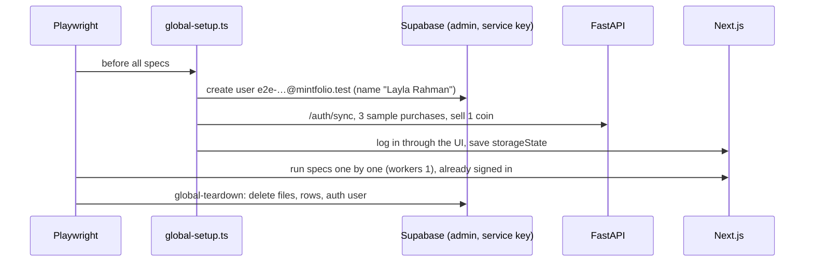

# Web development guide

> **What this covers:** setting up, configuring, running, testing and deploying `mintfolio-web`.
> Running both repos together: [Setup and running](https://github.com/aa055/mintfolio-docs/blob/main/docs/06-setup-and-running.md) · [Testing, QA and debugging](https://github.com/aa055/mintfolio-docs/blob/main/docs/07-testing-qa-and-debugging.md). Hosting decisions: [Deployment](https://github.com/aa055/mintfolio-docs/blob/main/docs/05-deployment-and-environments.md).

---

## 1. Setup

```powershell
npm install
copy .env.example .env.local     # fill in the 3 values below
npm run dev                      # http://localhost:3000
```

The API must be running (default `http://localhost:8000`) for any signed-in page to load.

| Variable | Example | Notes |
|---|---|---|
| `NEXT_PUBLIC_SUPABASE_URL` | `https://REF.supabase.co` | Must be the **same project** as the API's `SUPABASE_URL` |
| `NEXT_PUBLIC_SUPABASE_PUBLISHABLE_KEY` | `sb_publishable_…` | Safe for the browser |
| `NEXT_PUBLIC_API_BASE_URL` | `http://localhost:8000` | Only used by server code |

A missing variable fails fast with "Missing required environment variable: …" (`lib/supabase/env.ts`).

---

## 2. Scripts

| Script | Does |
|---|---|
| `npm run dev` | Dev server with hot reload |
| `npm run build` · `npm start` | Production build, then serve it |
| `npm run typecheck` | `tsc --noEmit` (strict) |
| `npm run lint` | `next lint` |
| `npm run test:e2e` | Playwright suite (§3) |

---

## 3. End-to-end tests (`e2e/`)

### How a run works



**Sample data** (`e2e/support.ts → createSeededUser`):
- **Emirates Gold, AED, cash:** a 24K 1 oz bar and 2 × 22K coins. The coins are sold today for 5,900 with 50 fees, to "Gold Souk".
- **BullionByPost, AED, card 2.5%:** 20 silver coins.
- **A London dealer, GBP:** a 916 coin, to test "other currencies".

### Specs (40 tests)

| Spec | Tests | Covers |
|---|---|---|
| `shell.spec.ts` | 5 | sidebar nav + `aria-current`, skip link, account menu, tablet rail / phone tabs / no sideways scroll, 404 |
| `home.spec.ts` | 5 | greeting from signup name, "spot" labels, chart's last point = Current value tile, range chips, recent-transactions windows |
| `transactions.spec.ts` | 4 | month groups and totals, filters + URL state, sell/undo + receipt upload/delete, delete a purchase |
| `holdings.spec.ts` | 4 | metal cards, Active default, premium under cost, rows open the purchase |
| `rates.spec.ts` | 2 | figures match `/prices/history`, switching survives reload |
| `profile.spec.ts` | 4 | signup name field, photo upload/remove, name change shows in menu, tola everywhere |
| `theme.spec.ts` | 2 | Light default, Dark persists and recolours charts, System follows the OS |
| `a11y.spec.ts` | 14 | axe WCAG 2.1 A/AA + best practice: 7 pages × light/dark |

### Run

```powershell
npx playwright install chromium        # once
copy .env.e2e.example .env.e2e         # once; set SUPABASE_SERVICE_ROLE_KEY
# start the API and npm run dev, then:
npm run test:e2e                       # all, a few minutes against the Singapore DB
npx playwright test e2e/home.spec.ts   # one file
npx playwright show-report             # HTML report, with traces of failures
```

Config (`playwright.config.ts`): Chromium, 1280×900, `workers: 1`, `retries: 0`, 120 s per test, 30 s per expect, and a trace kept on failure.

### Writing a spec
- Import `ready()` from `./support` and call it after `page.goto()`. It waits for hydration before you click.
- Prefer roles and accessible names (`getByRole("button", { name: "Sell" })`, `toHaveAccessibleName`) over CSS selectors.
- Normalise money text with `norm()`, because Intl uses a non-breaking space after `AED`.
- If a test changes shared settings (unit, name, theme), **put them back** at the end, and use `test.describe.configure({ mode: "serial" })`.
- Confirm dialogs: `page.on("dialog", d => d.accept())`.
- Need extra data? Use `apiAs(readUser())` to call the API as the test user.

---

## 4. Conventions

- **Semantic colour tokens only** (`bg-primary`, `text-foreground-muted`), never brand scales (`bg-olive-600`).
- **Type-scale utilities** (`text-display-lg`, `text-h2`, `text-body-sm`), not raw sizes.
- **Numbers get `num`**, so they use tabular digits.
- **Never remove a focus ring**; restyle `:focus-visible` instead.
- Format money and weights with the helpers in `lib/utils.ts`; never with `toFixed` in components.
- Fetch in Server Components; mutate through Server Actions that return `{ok, …}`.
- When the API changes, update `lib/api-types.ts` in the same change.
- New page checklist: `page.tsx` + `loading.tsx`, add it to `components/shell/nav.ts` (if it's a section) and to `PROTECTED_PREFIXES` in `lib/supabase/middleware.ts`, an empty state, and an e2e test (add it to `a11y.spec.ts` `PAGES`).

---

## 5. Deploying to Vercel

1. Import the repo in Vercel (framework preset: Next.js, root = repo root).
2. Add the three `NEXT_PUBLIC_*` variables with **production** values (`NEXT_PUBLIC_API_BASE_URL` = the deployed API).
3. **Settings → Functions → Region**: the same region as the API and database. Server code does all API calls, so this is where latency is decided.
4. In Supabase → Auth → URL configuration, add `https://<your-domain>/auth/callback` to the redirect URLs and set the Site URL.
5. Deploy, then run the smoke test in [Deployment §5](https://github.com/aa055/mintfolio-docs/blob/main/docs/05-deployment-and-environments.md#5-launch-checklist).
