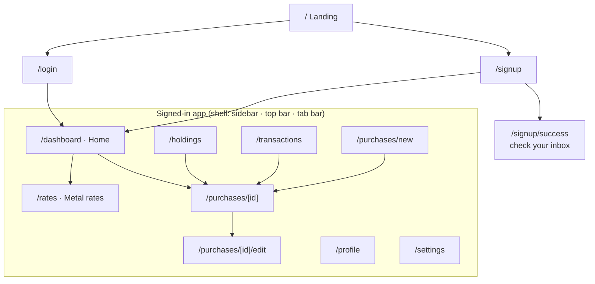
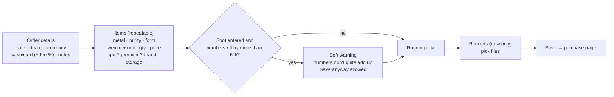

# UI/UX guide

> **What this covers:** every screen, what it shows, what you can do there, how it adapts to screen size, and the accessibility and content rules.
> **Related:**
> - [design-system.md](design-system.md): colours, type, spacing
> - [ui-ux-plan.md](ui-ux-plan.md): the revamp plan, research, and step results
> - [architecture.md](architecture.md): how the pages are built

---

## 1. Site map



- **Sidebar (desktop):** + Add purchase · Home · Holdings · Transactions · Metal rates · Settings.
- **Avatar menu (top-right):** your name and email, then Profile · Settings · Theme (Light / Dark / System) · Sign out.
- **Section highlighting:** `/purchases/*` pages highlight **Transactions**.

---

## 2. The app shell at each screen size

```
Desktop ≥ 1024 px                         Tablet 640–1023 px      Phone < 640 px
┌───────────┬───────────────────────┐     ┌──┬──────────────┐     ┌──────────────┐
│ Mintfolio │              [Avatar▾]│     │◉ │     [Avatar▾]│     │◉ Mintfolio  ●│
│ [+ Add]   ├───────────────────────┤     │+ ├──────────────┤     │              │
│ ⌂ Home    │                       │     │⌂ │              │     │   content    │
│ ▤ Holdings│       content         │     │▤ │   content    │     │              │
│ ⇄ Transac.│   (max width 6xl)     │     │⇄ │              │     │              │
│ 〽 Rates   │                       │     │〽│              │     ├──────────────┤
│ ⚙ Settings│                       │     │⚙ │              │     │⌂  ▤  (+)  ⇄ 〽│
└───────────┴───────────────────────┘     └──┴──────────────┘     └──────────────┘
  240 px sidebar with labels               64 px icon rail          bottom tab bar
                                           (labels as tooltips)     (+ = Add purchase)
```

There is never any sideways scrolling at 1280, 800 or 390 px. This is tested in `e2e/shell.spec.ts`.

---

## 3. Screens

### 3.1 Home (`/dashboard`)

```
Good evening, Layla                         ┌ Gold 24K · spot ┐ ┌ Silver 999 · spot ┐
Saturday, 17 October                        │ AED 491.75 /g    │ │ AED 7.27 /g       │
                                            │ ▲ 0.42% today    │ │ ▼ 0.18% today     │
┌ Total invested ┐┌ Current value ┐┌ Today ──────┐┌ All-time ─────┐
│ AED 20,800     ││ AED 27,025    ││ ▲ +AED 112  ││ ▲ +AED 6,225  │
└────────────────┘└───────────────┘└─────────────┘└───────────────┘
┌ Portfolio value ───────────────────── [1M][3M][6M][YTD][1Y][ALL] ┐
│  area = value   - - - dashed = net invested   (hover: tooltip)   │
└──────────────────────────────────────────────────────────────────┘
┌ Allocation by metal ────────┐ ┌ Recent transactions [7D][1M][1Y][All] ┐
│ ███████████░░░ Gold 83%     │ │ BUY  10 Mar  Emirates Gold  AED 16,900 │
│ weight · value · P/L table  │ │ SELL 17 Oct  Gold 22K coin  AED  5,900 │
└─────────────────────────────┘ └──────────────────── View all → ───────┘
```

| Part | Detail |
|---|---|
| Greeting | Time-of-day greeting and date, in **your time zone**. |
| Rate cards | Pure gold and silver **spot** per gram, with the change since the previous price day. They link to Metal rates. |
| Tiles | Total invested · Current value · Today (hidden in manual mode) · All-time (split into unrealized and realized in small text). |
| Chart | Value vs net invested, ranges 1M–ALL. The headline shows "Gain over <range>", including realized sales. **The last point equals the Current value tile.** |
| Allocation | A bar plus a table per metal. |
| Recent transactions | The last 5 in the chosen window, with "View all" → Transactions. |
| Notices | E.g. "1 in other currencies not totalled", or items that couldn't be valued. |
| Empty state | "No purchases yet", with an Add purchase button. |

### 3.2 Holdings (`/holdings`)
What you own **now**.

| Part | Detail |
|---|---|
| Metal cards | Per metal: total weight, current value, cost, P/L, **average cost per gram/oz/tola**. Your currency only (the card says so). |
| Filters | Metal · Status (**Active** by default, Sold, or Active + sold) · Form · Dealer · Search · Sort (date, weight, cost, value or P/L, ascending or descending). All kept in the URL. |
| Table (desktop) | Item · Purchased (date + dealer) · Weight · Cost (with **premium over spot** beneath; full detail in a tooltip and in screen-reader text) · Value now · P/L. Rows open the purchase. |
| Cards (phone) | The same data, stacked. |
| Empty states | "No holdings yet" · "No items match these filters." |

### 3.3 Transactions (`/transactions`)
Every buy and sell, exactly once.

| Part | Detail |
|---|---|
| Filters | Type (All / Purchases / Sales) · Date (7D / 1M / 3M / 1Y / All) · Metal · Search (dealer, item, buyer). Kept in the URL. **Reset** clears them. |
| List | Grouped under month headers. A **purchase row** shows date, dealer, "Gold 24K bar + 1 more", total, payment method and a receipt icon. A **sale row** shows item, buyer, price and realized P/L. |
| Totals | For what's shown: Bought · Sold · Realized · Net invested. It notes "N in other currencies not totalled". |
| Empty states | "No transactions yet" · "No transactions match these filters." |

### 3.4 Purchase detail (`/purchases/[id]`)

| Part | Detail |
|---|---|
| Header | Dealer, date, then "Cash · 2 items · 1 receipt", with **Edit** and **Delete** (confirmation). |
| Items table | Weight, cost, value now, P/L, premium over spot, and **Sell** or **Undo sale** per item. Sold items show realized P/L. |
| Sell dialog | Sale price, currency, date, buyer, fees, optional spot, notes. |
| Receipts | Thumbnails or PDF tiles. Open each in a new tab. Add more (JPG/PNG/PDF ≤ 5 MB). Delete on hover/focus. |
| Notes | The purchase notes. |

### 3.5 Add / edit purchase (`/purchases/new`, `/purchases/[id]/edit`)



- Every field has a linked label and hint/error text (`aria-describedby`, `aria-invalid`).
- A card payment reveals "Card premium %", with the hint "Most dealers charge ~2.5%".
- When editing, sold items can't be removed (the API returns a clear message).

### 3.6 Metal rates (`/rates`)

| Part | Detail |
|---|---|
| Switch | **Gold \| Silver**. Each has its own chart; the two never share an axis, because their scales differ about 70×. |
| Header | Price per gram (pure), per troy oz and per tola, and the day change. |
| Chart | A line, zoomed to the range: 1M · 3M · 6M · 1Y · 5Y. The tooltip shows date and rate. |
| Stats | Change over the range, range high/low, 52-week high/low. |
| Purity table | Gold 24K / 22K / 21K / 18K, per gram and per tola. Silver: Fine, 999, 925. |
| Credit | "Daily rates: GoldAPI.io · History: metals.dev". |
| Empty state | "No price history in {currency} yet" (only AED has data today). |

All 5 years load once, so switching metal or range is instant.

### 3.7 Profile (`/profile`)
- **Photo:** choose a JPG/PNG/WebP ≤ 2 MB → preview ("save to use this photo") → Save. **Remove** goes back to the Google photo or your initials.
- **Name:** editable; shown in the avatar menu and the Home greeting.
- **Account (read-only):** email, sign-in method (Email and password / Google), member since.

### 3.8 Settings (`/settings`)
- **Preferences:** currency, time zone, pricing mode (Live / Manual), and **Show weights in** (Grams / Troy oz / Tola (11.66 g)).
- **Manual rates:** pure gold and silver per gram plus their currency. They're used when the pricing mode is Manual.
- A link to Profile for name and photo.

### 3.9 Auth pages
Login (email/password + Google), Signup (**name**, email, password ≥ 8, + Google), and "Check your inbox" after signup when confirmation is on. Errors appear inline; expired email links come back to Login with a friendly message.

---

## 4. States every page handles

| State | What the user sees | Built with |
|---|---|---|
| Loading | A skeleton shaped like the page, announced once to screen readers | `loading.tsx` + `page-skeletons.tsx` |
| Empty | A friendly message and the next action ("Add purchase") | per page |
| Error | "Something went wrong loading this page" + **Try again**; the shell still works | `(app)/error.tsx` |
| Not found | Branded 404 + "Back to Home" | `app/not-found.tsx` |
| Partial data | A notice: other currencies left out, items unvalued, no manual rates | `SummaryNotices` |

---

## 5. Accessibility

Target: **WCAG 2.1 AA**. **0 axe violations** on 7 pages × 2 themes (`e2e/a11y.spec.ts`).

| Rule | How it's met |
|---|---|
| Keyboard | "Skip to content" is the first Tab stop; nav in order; all actions reachable; visible focus ring everywhere (never removed). |
| Current page | `aria-current="page"` on the active nav item. |
| Labels | Every input has a label, and every select trigger an `aria-label` ("Item 2 metal"…). Icon-only buttons have screen-reader text. |
| Contrast | All text pairs checked in both themes (≥ 4.5:1 body, ≥ 3:1 large / UI). Chart colours were validated for colour-blind separation. |
| Colour is never alone | P/L has a sign and ▲▼ as well as colour; charts have a legend and tooltip. |
| Motion | `prefers-reduced-motion` shortens all animation. |
| Menus | The account menu is non-modal, so it doesn't hide the page from assistive tech. |
| Headings | One `h1` per page (auth pages included). |

---

## 6. Content and number rules

- Say **spot** wherever a market rate is shown (rate cards, Home).
- Money uses the currency code and grouping: `AED 12,441.40`. Gains and losses carry a sign: `+AED 250.00`, `−AED 191.93`.
- Weights use the user's unit: `31.104 g`, `1.000 oz`, `2.667 tola`. Averages follow it: "Avg cost / tola".
- Dates: `10 Mar 2026` (en-GB). Date-only values are formatted in UTC so they never shift a day.
- Numbers use tabular digits (`num` class), so columns line up.
- Be explicit about gaps: "1 in other currencies not totalled", or "Today" hidden in manual mode.
- Data credit under rate charts: "Daily rates: GoldAPI.io · History: metals.dev".

---

## 7. Themes

Light (default) and Dark, or System (follows the OS live). The choice is saved per device in `localStorage` (`mintfolio-theme`) and applied before first paint, so there's no flash. Charts recolour live. How it works: [architecture.md §6](architecture.md#6-theming).
